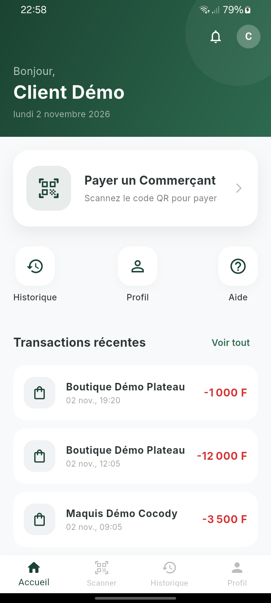
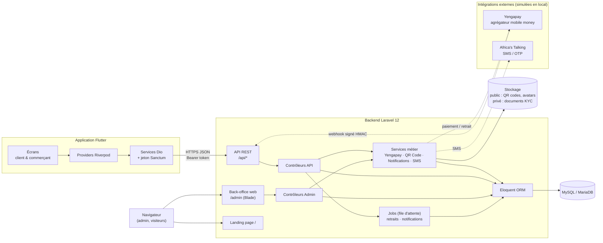

<div align="center">

# IvoirePay

**Paiement marchand par QR code pour la Côte d'Ivoire — API Laravel, back-office web et application mobile Flutter.**

[Démonstration visuelle](https://cedrickemmanuel25.github.io/ivoirepay/) · [Architecture](#6-architecture-technique) · [Installation](#13-installation-du-backend-laravel) · [Tests](#17-exécution-des-tests) · [Étude de cas](docs/PORTFOLIO_CASE_STUDY.md)


</div>

---

## 1. Présentation

IvoirePay est un produit complet de paiement par QR code, couvrant le serveur, le web et le mobile :

- une **API REST Laravel** qui gère l'authentification par téléphone, les paiements, les soldes commerçants, les retraits et le KYC ;
- un **back-office web** (Blade) pour l'équipe d'exploitation : validation KYC, suivi des transactions, retraits, utilisateurs, notifications ;
- une **landing page publique** ;
- une **application mobile Flutter** unique pour deux profils : le **client** qui scanne et paie, le **commerçant** qui encaisse, suit son activité et demande des retraits.

> Projet de portfolio. Aucun fournisseur de paiement réel n'est appelé dans la configuration fournie : les paiements et retraits sont **simulés** (voir [§18](#18-sécurité-et-limites-connues)).

## 2. Problématique métier

En Côte d'Ivoire, l'argent mobile (Wave, Orange Money, MTN MoMo, Moov Money, Djamo) est omniprésent, mais chaque portefeuille a son propre parcours. Un petit commerçant doit gérer plusieurs numéros, vérifier chaque transfert à la main et rendre la monnaie.

IvoirePay propose **un seul QR code statique par commerçant** : le client le scanne, choisit son portefeuille, saisit le montant, confirme avec son PIN, et le solde du commerçant est crédité.

## 3. Objectifs

- Un parcours de paiement en quelques secondes : scan → montant → PIN.
- Une ouverture de compte sans mot de passe : numéro de téléphone + OTP, puis PIN à 4 chiffres.
- Un commerçant vérifié (KYC) avant de pouvoir encaisser.
- Des mouvements d'argent **cohérents et idempotents** : pas de double crédit, pas de double remboursement.
- Un back-office qui donne à l'exploitant la main sur la conformité et les retraits.

## 4. Aperçu — landing page

Capture pleine page (viewport 1440 × 1024, Playwright / Chromium) :

<p align="center">
  
</p>

## 5. Aperçu — application mobile

Écran d'accueil client réel, après le parcours téléphone → OTP → PIN d'un compte de démonstration fictif. Capture native sur un appareil Android (720 × 1600) :

<p align="center">
  
</p>

## 6. Architecture technique



**Communication mobile ↔ backend** : l'application consomme `/api` en JSON avec Dio. Après OTP ou PIN, l'API renvoie un jeton **Laravel Sanctum** stocké dans `flutter_secure_storage` et ajouté par intercepteur (`Authorization: Bearer …`). L'URL de l'API est injectée à la compilation (`--dart-define=API_BASE_URL`), voir [§15](#15-configuration-de-la-communication-api).

## 7. Technologies

| Couche | Technologies réellement utilisées |
|---|---|
| Backend | PHP 8.2+, Laravel 12, Laravel Sanctum, Eloquent, Queues (driver `database`) |
| Base de données | MySQL / MariaDB (tests automatisés sur SQLite en mémoire) |
| Back-office & landing | Blade, Tailwind CSS (CDN), Alpine.js, AOS, Font Awesome |
| Documents | barryvdh/laravel-dompdf (reçus et exports PDF), maatwebsite/excel (export CSV) |
| QR code | simplesoftwareio/simple-qrcode (SVG) |
| Mobile | Flutter / Dart 3.9, Riverpod 3, go_router, Dio, flutter_secure_storage, mobile_scanner, local_auth, fl_chart, flutter_svg, pdf / printing, lottie |
| Intégrations | Yengapay (paiement mobile money), Africa's Talking (SMS) |
| Qualité | PHPUnit 11, flutter_test, Playwright (audit et capture de la landing) |

## 8. Fonctionnalités clés du backend

- **Authentification par téléphone** : envoi d'OTP à 6 chiffres (validité et nombre d'essais configurables), inscription client ou commerçant, création et changement du PIN, connexion par PIN avec suspension après 5 échecs.
- **Paiement** : initiation après scan (montant ≥ 100 FCFA, commerçant approuvé), confirmation par PIN, verrou anti double-envoi, crédit du solde sous verrou de ligne.
- **Webhook Yengapay** : signature HMAC-SHA256 obligatoire, rejeu sans effet, un statut final ne peut pas être écrasé.
- **Commerçant** : profil, QR code SVG, tableau de bord (jour, mois, graphique 7 jours), historique filtrable.
- **Retraits** : PIN requis, réservation du solde sous verrou, traitement en file d'attente, remboursement unique en cas d'échec.
- **KYC** : dépôt de pièces (JPG / PNG / PDF ≤ 5 Mo) sur disque **privé**, statut consultable par le commerçant.
- **Notifications in-app** et SMS, reçu PDF par transaction.

## 9. Fonctionnalités clés de l'application Flutter

- Splash avec validation du jeton, onboarding, saisie du numéro, OTP, inscription, création du PIN.
- Connexion par PIN (pavé numérique dédié) et option biométrique (`local_auth`).
- **Client** : accueil avec dernières transactions, scanner QR, paiement en choisissant son portefeuille, écran de succès, historique filtrable et détail, téléchargement du reçu PDF, profil et avatar.
- **Commerçant** : assistant KYC avec upload de documents, écrans « en attente » et « rejeté », tableau de bord avec graphique, QR code plein écran et partage, historique, demande et historique de retraits.

## 10. Fonctionnalités de l'administration

Accessible sur `/admin` (session dédiée, réservée au rôle `admin`) :

- tableau de bord : volume du jour, commerçants actifs, KYC en attente, graphique 7 jours, répartition par portefeuille ;
- **KYC** : liste filtrable, consultation des pièces par **URL signée temporaire**, approbation (génération du QR et SMS) ou rejet motivé ;
- transactions avec export **PDF** et **CSV** ;
- commerçants : fiche, activation / suspension, téléchargement du QR ;
- retraits : lancement du traitement ou annulation avec remboursement ;
- utilisateurs : recherche, fiche, suspension, SMS individuel, suppression ;
- notifications : envoi groupé (clients, commerçants, tous) en in-app et/ou SMS via un job ;
- profil administrateur et paramètres (montant minimum de retrait, téléphone du support…).

## 11. Structure des dossiers

```
ivoirepay/
├── backend/                 Application Laravel (API, back-office, landing)
│   ├── app/Http/Controllers/{Api,Admin}
│   ├── app/{Models,Services,Jobs,Exports}
│   ├── database/{migrations,seeders,factories}
│   ├── resources/views/     landing, back-office Blade
│   ├── routes/{api,web}.php
│   └── tests/Feature/       parcours critiques (paiement, retraits, auth, admin)
├── mobile/                  Application Flutter (Android, iOS, web, desktop)
│   ├── lib/core/            config API, modèles, routeur, services
│   ├── lib/features/        auth, home, payment, transactions, kyc, profile, onboarding
│   └── test/
├── docs/                    Site GitHub Pages, captures, étude de cas, rapport d'audit
│   ├── index.html
│   ├── demo/
│   ├── screenshots/
│   ├── PORTFOLIO_CASE_STUDY.md
│   └── AUDIT_REPORT.md
├── portfolio-export/        Dossier prêt pour un portfolio
├── README.md
└── .gitignore
```

## 12. Configuration MySQL

```sql
CREATE DATABASE ivoirepay_portfolio CHARACTER SET utf8mb4 COLLATE utf8mb4_unicode_ci;
```

Dans `backend/.env` :

```dotenv
DB_CONNECTION=mysql
DB_HOST=127.0.0.1
DB_PORT=3306
DB_DATABASE=ivoirepay_portfolio
DB_USERNAME=root
DB_PASSWORD=
```

Testé avec MariaDB 10.4 (XAMPP). Toute base MySQL 8 compatible convient.

## 13. Installation du backend Laravel

Prérequis : PHP 8.2+ (extensions `pdo_mysql`, `gd`, `zip`), Composer 2.

```bash
cd backend
composer install
cp .env.example .env          # YENGAPAY_SIMULATE=true par défaut
php artisan key:generate
php artisan migrate
php artisan storage:link
php artisan db:seed --class=DemoSeeder   # données 100 % fictives, idempotent
```

Les vues chargent Tailwind, Alpine et AOS depuis leurs CDN : aucun build front n'est nécessaire.

**Comptes de démonstration** (fictifs) :

| Rôle | Identifiant | Secret |
|---|---|---|
| Administrateur | `admin@ivoirepay.ci` sur `/admin/login` | `123456` |
| Client | téléphone `0000000001` | PIN `1234` |
| Commerçant approuvé | téléphone `0000000002` | PIN `1234` |
| Commerçant en attente KYC | téléphone `0000000003` | PIN `1234` |

Les numéros `+225 00 00 xx xx xx` n'appartiennent à aucun préfixe d'opérateur ivoirien. Changez le mot de passe administrateur hors démo.

## 14. Installation de l'application Flutter

Prérequis : Flutter stable (Dart ≥ 3.9, testé avec Flutter 3.47), Android SDK, JDK 17+ (celui d'Android Studio convient), un émulateur ou un appareil Android. Chaîne de build Android : Gradle 8.14.3, AGP 8.11.1, Kotlin 2.2.20.

```bash
cd mobile
flutter pub get
flutter run --dart-define=API_BASE_URL=http://10.0.2.2:8000/api
```

## 15. Configuration de la communication API

L'URL de base est définie dans [`mobile/lib/core/config/api_config.dart`](mobile/lib/core/config/api_config.dart) et surchargée au build. Aucune URL de tunnel n'est codée en dur.

| Cible | Valeur de `API_BASE_URL` |
|---|---|
| Émulateur Android (valeur par défaut) | `http://10.0.2.2:8000/api` |
| Appareil physique en USB | `adb reverse tcp:8000 tcp:8000` puis `http://127.0.0.1:8000/api` |
| Appareil sur le même Wi-Fi | `http://<IP-du-PC>:8000/api` + `php artisan serve --host=0.0.0.0` |
| Serveur déployé | `https://votre-domaine/api` |

Les URL absolues renvoyées par l'API (QR code, fichiers) sont construites depuis `APP_URL` : placez-y une adresse joignable par le téléphone.

## 16. Démarrage local

```bash
# Terminal 1 — API + back-office
cd backend && php artisan serve --host=0.0.0.0 --port=8000

# Terminal 2 — file d'attente (retraits / notifications en mode non simulé)
cd backend && php artisan queue:work

# Terminal 3 — application mobile
cd mobile && flutter run --dart-define=API_BASE_URL=http://10.0.2.2:8000/api
```

- Landing : <http://127.0.0.1:8000>
- Back-office : <http://127.0.0.1:8000/admin/login>
- Santé : <http://127.0.0.1:8000/up>

En mode simulé, l'OTP n'est pas envoyé par SMS. Il apparaît dans `storage/logs/laravel.log` (ligne `[AFRICA_TALKING_MOCK]`) et dans la table `otp_codes`.

## 17. Exécution des tests

```bash
cd backend && php artisan test     # 39 tests — SQLite en mémoire, fournisseurs mockés
cd mobile  && flutter test         # 7 tests — modèles, configuration API, widget PIN
```

Les tests Laravel couvrent l'inscription OTP, le PIN, les autorisations, l'idempotence des webhooks, le mode simulation, la vérification de signature, les retraits (PIN, solde, double traitement, double remboursement), la confidentialité des documents KYC et le rendu de chaque écran d'administration. Le détail des vérifications se trouve dans [docs/AUDIT_REPORT.md](docs/AUDIT_REPORT.md).

## 18. Sécurité et limites connues

**Mesures en place** : PIN haché (bcrypt), jamais exposé par l'API ; OTP absent des journaux applicatifs ; webhooks refusés sans secret ou avec une signature invalide ; crédit et retrait sous verrou de ligne ; transitions de statut conditionnelles (pas de double crédit ni de double remboursement) ; documents KYC sur disque privé servis par URL signée ; accès admin limité au rôle `admin` ; logs HTTP mobiles désactivés hors debug.

**Limites** :

- **Paiements simulés** : l'intégration Yengapay n'a pas été validée contre le fournisseur réel dans ce dépôt. Le format exact du webhook (`provider_ref`, `status`) reprend l'implémentation existante.
- La commission est fixée à 0 dans le code, bien qu'un paramètre `commission_rate` existe.
- Pas de limitation de débit (rate limiting) dédiée sur `send-otp` ni sur la confirmation de paiement.
- La landing contient des chiffres marketing de démonstration (« 5 000+ transactions / jour »…) et des liens `#` (stores, réseaux sociaux) : **ce ne sont pas des statistiques réelles**.
- Le formulaire de contact journalise les messages sans envoyer d'e-mail.
- Dépendances installées mais non utilisées : `intervention/image`, `spatie/laravel-permission` (backend), `qr_flutter`, `get_storage`, `cached_network_image` (mobile).
- 22 avertissements `flutter analyze` hérités (imports inutilisés), sans impact fonctionnel.

## 19. Auteur

Développeur full-stack (Laravel · Flutter) — GitHub : [@cedrickemmanuel25](https://github.com/cedrickemmanuel25)

Le code mobile provient de l'ancien dépôt [`web-mobile`](https://github.com/cedrickemmanuel25/web-mobile) (commit `e2b616c`), réuni ici dans un dépôt unique. Voir [docs/AUDIT_REPORT.md](docs/AUDIT_REPORT.md#origine-des-sources).

## 20. Démonstration visuelle

Galerie statique (landing + écran d'accueil mobile, architecture) publiée avec GitHub Pages depuis `/docs` :
**<https://cedrickemmanuel25.github.io/ivoirepay/>**
