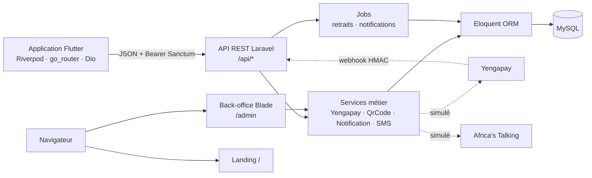

# Architecture — IvoirePay



## Organisation du dépôt

```
backend/   Laravel : app/Http/Controllers/{Api,Admin}, Services, Jobs, Models, migrations, tests
mobile/    Flutter : lib/core (config, modèles, routeur, services), lib/features/* (un dossier par parcours)
docs/      GitHub Pages, captures, étude de cas, rapport d'audit
```

## Modèle de données

| Table | Rôle |
|---|---|
| `users` | clients, commerçants, admins (`role`), PIN haché, état actif |
| `merchants` | profil commerçant 1-1 avec `users`, statut KYC, **solde**, chemin du QR |
| `kyc_documents` | pièces justificatives (disque privé) |
| `transactions` | paiements : montant, portefeuille, statut `pending / success / failed / refunded`, référence fournisseur |
| `withdrawal_requests` | retraits : `pending / processing / completed / failed` |
| `otp_codes` | OTP avec expiration et compteur d'essais |
| `notifications` | notifications in-app |
| `settings`, `activity_logs` | paramètres et journal des connexions admin |

## Flux d'un paiement

1. `POST /api/transactions/initiate` : contrôle du commerçant approuvé et du montant, transaction `pending`.
2. `POST /api/transactions/{id}/confirm` : vérification du PIN, verrou anti double-envoi, appel au fournisseur (ou simulation).
3. `POST /api/webhooks/yengapay` : vérification HMAC, puis, sous verrou de ligne, `pending → success` et crédit du solde.
4. Notification in-app au commerçant et SMS au client.

## Flux d'un retrait

1. `POST /api/merchant/withdrawal` : vérification du PIN ; solde réservé sous verrou.
2. `ProcessWithdrawalJob` : prise en charge atomique `pending → processing`, appel au fournisseur.
3. Succès → `completed`. Échec → `failed` et remboursement unique. L'admin peut annuler un retrait `pending`.
