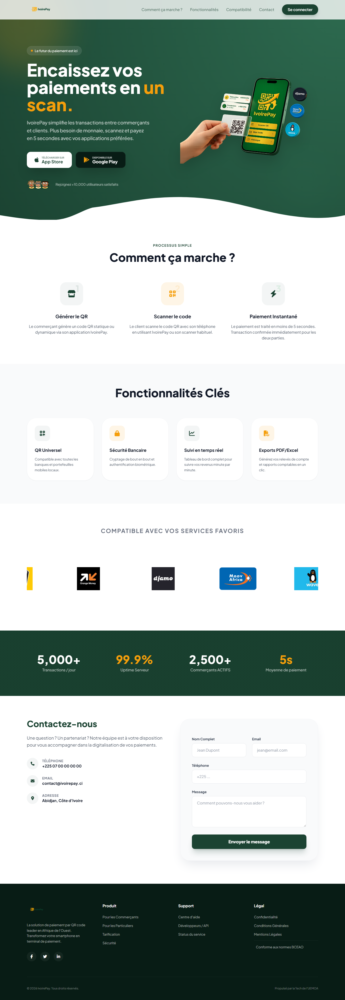
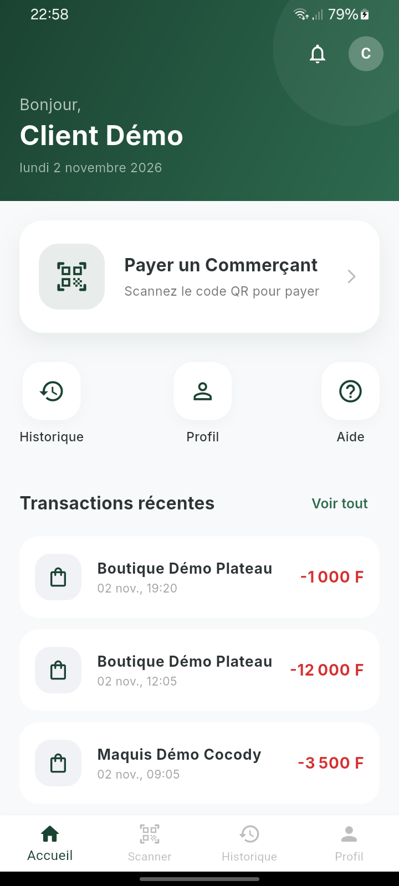

# Captures — IvoirePay

Deux captures authentiques, sans retouche ni maquette.

## 1. Landing page web

- Fichier : `screenshots/ivoirepay-landing-desktop.png`
- Viewport 1440 × 1024, capture pleine page de **1440 × 4163 px**
- Playwright + Chromium : chargement complet, défilement pour déclencher les animations, retour en haut, `fullPage: true`
- Source : `backend/resources/views/landing.blade.php` servi par `php artisan serve`

## 2. Application mobile — accueil client

- Fichier : `screenshots/ivoirepay-mobile-home.png`
- Écran d'accueil réel après le parcours complet téléphone → OTP → PIN du compte de démonstration fictif « Client Démo »
- APK debug installé sur un Samsung Galaxy A04 (Android 14), capture native `adb screencap` de **720 × 1600 px**, portrait
- Données chargées depuis l'API Laravel locale (via `adb reverse`)

Les chiffres visibles sont des données de démonstration fictives.
